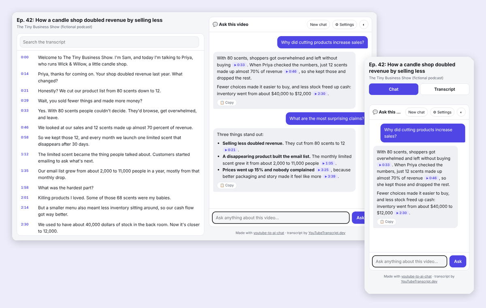
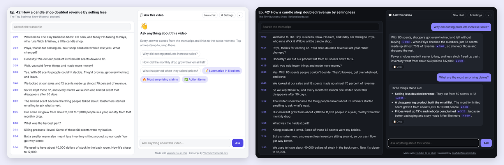

<div align="center">

# 💬 YouTube to AI Chat

### Ask any YouTube video anything. Every answer links to the exact second. ⏱️

[](LICENSE)
[](#-get-started-in-60-seconds)
[](#-get-started-in-60-seconds)



**Stop scrubbing through 2-hour podcasts.** 🎧 Paste a link, ask a question, and get a straight answer with receipts.

</div>

---

## ✨ Two ways to use it

### 1. 💬 Chat right in Claude

> **You:** What did they say about pricing? https://youtube.com/watch?v=…
>
> **Claude:** They raised prices **15% at the relaunch and nobody complained** [3:25], because better packaging and storytelling made customers feel they were getting more, not less [3:39].

✅ Answers come only from the video · ⏱️ Every claim has a clickable timestamp · 🙅 If the video doesn't cover it, Claude says so instead of guessing · 🌍 Ask in any language

### 2. 🌐 Build a shareable "chat with this video" page

> *"Make a chat page for this webinar that I can send to my team"*

You get **one HTML file** with:

| | |
|---|---|
| 🎬 **The video** | Embedded, with a clickable transcript that follows along |
| 🔎 **Transcript search** | Find every mention of any word instantly |
| 💬 **AI chat** | Answers cite moments as ⏱️ chips that jump the video |
| ⚡ **One-tap questions** | 📝 Summarize · 🔥 Surprising claims · ✅ Action items, plus questions written for that video |
| 📋 **Copy answers** | Paste straight into notes, docs, or Slack |
| 🧠 **Pick your model** | Claude Opus 5.5, Sonnet 5.5, or Haiku 5.5 |
| 🌗 **Light & dark mode** | And a phone layout with Chat / Transcript tabs |



👉 **[See the example page](examples/candle-shop-podcast-chat.html)** (download it and open in your browser): a fictional podcast about a candle shop that doubled revenue by selling less. Add your Anthropic key in ⚙️ Settings and it really works.

**🔒 No server, no cost to you.** The page talks to Claude straight from each viewer's browser using *their own* Anthropic API key. The key goes only to Anthropic and is saved only if the viewer chooses. Answers typically cost a cent or two.

---

## 🚀 Get started in 60 seconds

### Option 1: Claude Code (desktop app, web, or terminal) ⭐ recommended

Type this into Claude Code:

```
/plugin install youtube-to-ai-chat --marketplace tstfully/youtube-to-ai-chat
```

Done! 🎉 Then just ask Claude in plain English.

**🎁 Want all three YouTube skills?** Paste all three lines:

```
/plugin install youtube-to-case-study --marketplace tstfully/youtube-to-case-study
/plugin install youtube-to-course --marketplace tstfully/youtube-to-course
/plugin install youtube-to-ai-chat --marketplace tstfully/youtube-to-ai-chat
```

<details>
<summary>Other ways to install</summary>

**Ask Claude to do it.** Paste this into Claude Code (or any coding agent):

> Install the youtube-to-ai-chat skill from https://github.com/tstfully/youtube-to-ai-chat, then help me connect a free YouTubeTranscript.dev API key without me pasting the key into this chat.

**Two-step plugin install** (older Claude Code versions):

```
/plugin marketplace add tstfully/youtube-to-ai-chat
/plugin install youtube-to-ai-chat@youtube-to-ai-chat
```

**Skills CLI** (works with Claude Code, Cursor, Codex, and other agents):

```bash
npx skills add tstfully/youtube-to-ai-chat
```

**Manual:**

```bash
git clone https://github.com/tstfully/youtube-to-ai-chat ~/.claude/skills/youtube-to-ai-chat
```

</details>

### Option 2: Claude.ai (no install at all)

1. Click the green **Code** button above → **Download ZIP**.
2. In Claude.ai, go to **Settings → Capabilities → Skills → Upload skill** and choose the ZIP.
3. Grab a transcript for free at [youtubetranscript.dev/tools/transcript](https://www.youtubetranscript.dev/tools/transcript), paste it into the chat, and start asking.

### Option 3: No AI account at all

Use the free [**Chat with Video**](https://www.youtubetranscript.dev/tools/chat) tool on YouTubeTranscript.dev. Paste a link and ask away, no login needed.

### 🔑 Connect transcripts (free, once)

| | How | Best for |
|---|---|---|
| 📋 **Paste it** | Copy a transcript from the [free tool](https://www.youtubetranscript.dev/tools/transcript) and paste it in | Trying it out, Claude.ai |
| 🔑 **API key** | Get a free key at [youtubetranscript.dev](https://youtubetranscript.dev) (**Dashboard → API Keys**) and save it as `YOUTUBETRANSCRIPT_API_KEY`. Claude can walk you through it. | Using it often |
| 🔌 **MCP server** | `claude mcp add --transport http youtubetranscript https://mcp.youtubetranscript.dev --header "x-api-token: YOUR_API_KEY"` | Claude Code, Claude Desktop, Cursor |

The free plan includes **10 videos a month**, no credit card. Videos without captions can be transcribed from the audio too.

> 🔒 **Never paste an API key into a chat**, a screenshot, or a shared doc. Type it into your settings yourself.

---

## 💬 Just ask

| You are… | Try this |
|---|---|
| 🔬 **A researcher** | *"What evidence do they give for that claim? Quote it with timestamps: [link]"* |
| 📣 **A marketer** | *"Pull the 5 most quotable lines for social posts: [link]"* |
| 🧭 **A PM** | *"What do customers in this interview complain about most? [link]"* |
| 🎓 **A student** | *"Explain the part about recursion again, but simpler: [link]"* |
| 🎙️ **A creator** | *"Write timestamped show notes and chapters for this episode: [link]"* |
| 💼 **An analyst** | *"What did the CEO say about guidance in this earnings call? [link]"* |

**More ideas:** 📝 *"Summarize in 5 bullets"* · ✅ *"Give me the action items as a checklist"* · 🤨 *"What would a skeptic push back on?"* · 🌐 *"Make a chat page I can share"*

---

## ❓ FAQ

<details>
<summary><b>Do I need to know how to code?</b></summary>
Nope. You ask in plain English. For the chat page, you get a file you double-click to open.
</details>

<details>
<summary><b>Is it really free?</b></summary>
The skill is free and open source (MIT). Transcripts are free for 10 videos a month on YouTubeTranscript.dev, or free anytime if you paste the transcript yourself. Chat-page answers use each viewer's own Anthropic key (usually a cent or two per answer).
</details>

<details>
<summary><b>Is my API key safe on the chat page?</b></summary>
The page has no backend. Your key goes only from your browser to Anthropic, and it's kept in memory unless you tick "Remember", which saves it in your own browser. It's never written into the file, so sharing the page never shares your key.
</details>

<details>
<summary><b>Will it make things up?</b></summary>
It's instructed to answer only from the transcript, to cite timestamps so you can check, and to say "the video doesn't cover that" when it doesn't.
</details>

<details>
<summary><b>Why doesn't the video play when I open the page from my computer?</b></summary>
Some browsers block YouTube embeds in local files. Timestamps then open YouTube in a new tab instead. Put the file on any website (GitHub Pages, Netlify, Vercel, your own site) and the embedded player works.
</details>

<details>
<summary><b>What languages work?</b></summary>
Any video with captions in 100+ languages. Ask in your language and get answers in your language.
</details>

---

## 🤖 For AI agents

If you are an AI agent helping a user with this repo:
- **Install (Claude Code):** `/plugin install youtube-to-ai-chat --marketplace tstfully/youtube-to-ai-chat`, or copy this folder to `~/.claude/skills/youtube-to-ai-chat`.
- **Entry point:** [`SKILL.md`](SKILL.md). Default to answering in chat with timestamp citations; build a page only when asked.
- **Transcript:** use the `youtubetranscript` MCP server if connected, else `scripts/fetch-transcript.mjs` with `YOUTUBETRANSCRIPT_API_KEY`, else ask the user to paste one from https://www.youtubetranscript.dev/tools/transcript. Never ask for API keys in chat.
- **Chat page:** build it with `scripts/build-chat-page.mjs`. Never hand-edit transcript text into HTML.
- **Summary for LLMs:** [`llms.txt`](llms.txt)

<details>
<summary>📁 What's inside</summary>

```
youtube-to-ai-chat/
├── SKILL.md                        # Step-by-step instructions the AI follows
├── assets/chat-template.html       # The chat page: player, transcript, chat
├── scripts/
│   ├── fetch-transcript.mjs        # Fetches transcripts (no dependencies)
│   └── build-chat-page.mjs         # Safely puts a transcript into the chat page
├── examples/                       # Finished example chat page
├── llms.txt                        # Summary for AI agents and search
└── .claude-plugin/                 # One-command install for Claude Code
```

</details>

---

## 💛 More free YouTube skills

| | |
|---|---|
| 📊 [**youtube-to-case-study**](https://github.com/tstfully/youtube-to-case-study) | Turn any video into a business, marketing, or UX case-study slideshow |
| 🎓 [**youtube-to-course**](https://github.com/tstfully/youtube-to-course) | Turn any video into an interactive course with quizzes and flashcards |

**Powered by [YouTubeTranscript.dev](https://youtubetranscript.dev):** YouTube transcripts in 100+ languages, AI transcription for videos without captions, and [free tools](https://www.youtubetranscript.dev/tools) with no login.

<sub>MIT licensed · ⭐ Star the repo if it saved you a rewatch!</sub>
